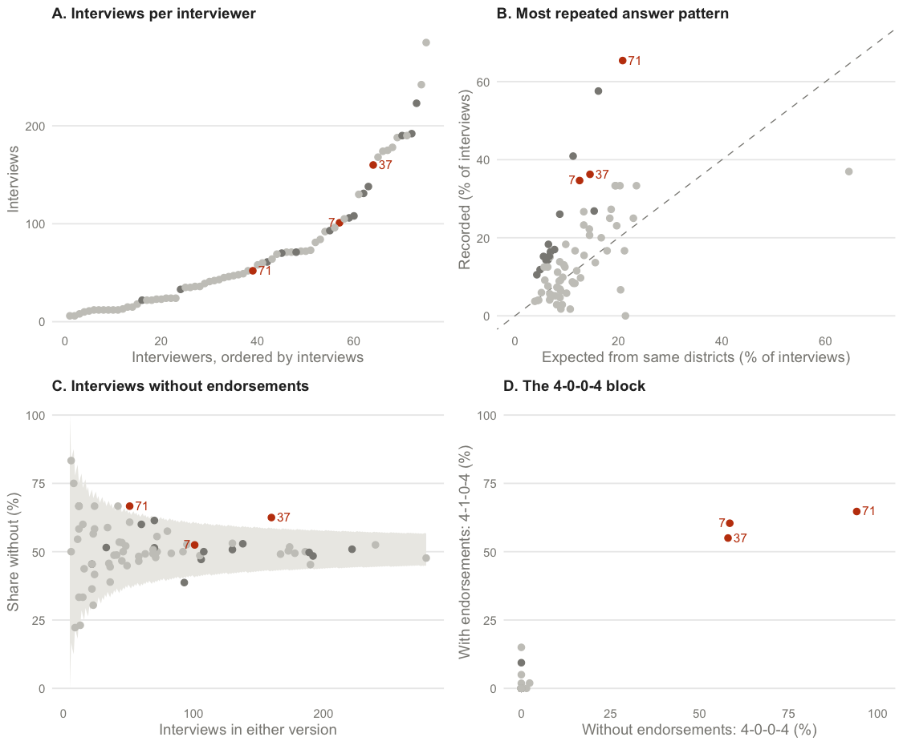

# Which Pakistanis Hold Militant Groups in "Low Regard"?

[](https://github.com/finite-sample/endorsement/actions/workflows/ci.yml)

Reanalysis of Blair, Fair, Malhotra, and Shapiro (2013), "Poverty and Support for Militant Politics: Evidence from Pakistan." The manuscript, the data, and every number in between are in this repository. Read the [paper on gsood.com](https://gsood.com/research/papers/endorsement.pdf); the repository copy is [ms/endorsement.pdf](ms/endorsement.pdf).

## Findings

Blair et al. conclude that poor Pakistanis dislike militant groups more than the middle class does, and read a small negative endorsement effect as evidence that Pakistanis hold the groups in low regard. In their data, respondents also appear to leave the middle of the scale in both directions under endorsement, as offsetting reactions would produce. All three features trace to three interviewers. Their published Tables 1–5 are rebuilt here from their replication files (`R/blair.R`) and recomputed without those interviewers.



<!-- BEGIN GENERATED RESULTS -->

Three of the survey's 75 interviewers (5.7% of interviews) recorded near-identical answer strings in most of their interviews. Their interviews, almost all with middle- and high-income respondents, make those respondents look warmer toward militant groups and produce the apparent movement in both directions that the published data show.

- **Blair et al.'s central estimate does not hold up.** The gap between the poor's and the middle class's reactions to an endorsement (their Table 2) moves from -0.018 (SE 0.010) to -0.008 (0.010) without the three interviewers, and is not distinguishable from zero in any of the four specifications of that table. The poor's reaction barely changes; the middle class's moves from -0.001 to -0.013. The urban-poor and violent-district contrasts shrink by 22% to 33%.
- **With all interviews,** endorsements lower policy support by -0.013 on the 0–1 scale (interviewer-clustered SE 0.007).
- **Without the three interviewers,** the effect is -0.021 (SE 0.005), the apparent movement out of the middle of the scale in both directions disappears, and the measurement model's share of favorable reactions moves from 43% to 38%, within the uncertainty of either estimate.
- **How many respondents react favorably is not identified by the data.** With a mean reaction near zero, the model's share follows from its assumption that reactions are normally distributed; a population in which no one reacts favorably fits as well.

<!-- END GENERATED RESULTS -->

The analysis is unweighted and describes the survey sample, not national prevalence. Standard errors are clustered by interviewer, and bootstrap intervals resample interviewers.

`exploration/reaction-models/` records attempts to estimate the share reacting favorably with Stan and mixed models, the assumptions each made, and why none produced a reportable number.

## Reproducing the Paper

Use R 4.6.0, the package versions in `renv.lock`, XeLaTeX with `latexmk` and BibTeX, and Poppler (`pdftotext`). Run commands from the repository root.

```sh
make restore
make paper
make check
```

`make paper` regenerates tables, manuscript numbers, and the results block above, then compiles `ms/endorsement.pdf`. `make check` runs R lint and tests, checks that generated text is current, builds the PDF, and checks references. `make format` applies styler. `make ci-docker` runs the same checks in a standard Rocker image.

The committed posterior summaries let you rebuild the paper without rerunning MCMC. To refit both samples, run `make fit`; to refit one, run `Rscript scripts/run.R fit full` (or `clean`, which excludes interviewers 7, 37, and 71). Each fit runs three dispersed chains in parallel with 200,000 iterations, 20,000 burn-in iterations, and thinning by 40. Optional iteration settings follow the sample name as three integers. A fit takes about 20 minutes.

Fits write ignored draws to `data/endorse_fits_<spec>.rds` and committed summaries to `data/endorse_<spec>.csv`. `make summarize` rebuilds summaries from saved draws without fitting; then run `make paper` to refresh the paper. Diagnostics include Gelman–Rubin statistics and effective sample sizes.

## Data

`data/pakistan_endorsement.csv` is built from Blair et al.'s replication file, `data/dataverse/fms09-data-weighted-20june.dta`, which records each respondent's interviewer and district. `make prepare` regenerates it: it keeps respondents with one substantive answer to each policy and a recorded interviewer, and reverses the survey's scale so that 5 is the most support. The [endorse](https://CRAN.R-project.org/package=endorse) package's `pakistan` dataset is a version of the same data without interviewer identifiers; a test checks that its respondents are in this file or lack a recorded interviewer.

Endorser codes, confirmed against Blair et al.'s Table 1: a = control, b = Kashmiri tanzeems, c = Afghan Taliban, d = al-Qa'ida, e = sectarian tanzeems. `data/dataverse/` preserves the original replication materials, including third-party R and Stata code.

## Repository Layout

```text
R/
  data.R       Input validation, factor coding, and response reshaping
  analysis.R   Interviewer screen, effects, within-respondent patterns, simulated worlds, and bounds
  blair.R      Blair et al.'s Tables 1-5 rebuilt from their Stata code, with and without the three interviewers
  model.R      Three-chain measurement-model fitting and posterior summaries
  paper.R      Tables, the interviewer figure, numerical macros, and README results
scripts/run.R  Single entry point: prepare, fit, summarize, analysis
tests/         testthat checks for data coding, estimands, bounds, and model summaries
data/          Committed inputs and posterior summaries; local draws are ignored
ms/            LaTeX source, bibliography, and compiled paper
tabs/          Generated tables and numerical macros
figs/          Generated figures
exploration/   Model attempts that did not produce a reportable estimate
DESCRIPTION    Direct R dependencies
renv.lock      Pinned R package versions
Makefile       Build order and checks
```

Calculations live in `R/analysis.R`; `R/paper.R` formats their results. There is one writer for each output.

## Citation

```
Sood, Gaurav. (2026). Which Pakistanis Hold Militant Groups in "Low Regard"? Three Interviewers in Blair et al.'s Endorsement Experiment.
https://github.com/finite-sample/endorsement
```

## License

Code and manuscript are MIT-licensed (see [LICENSE](LICENSE)). The files under `data/dataverse/` are Blair et al.'s replication materials, redistributed for reference under their original terms; `data/pakistan_endorsement.csv` is derived from them.
